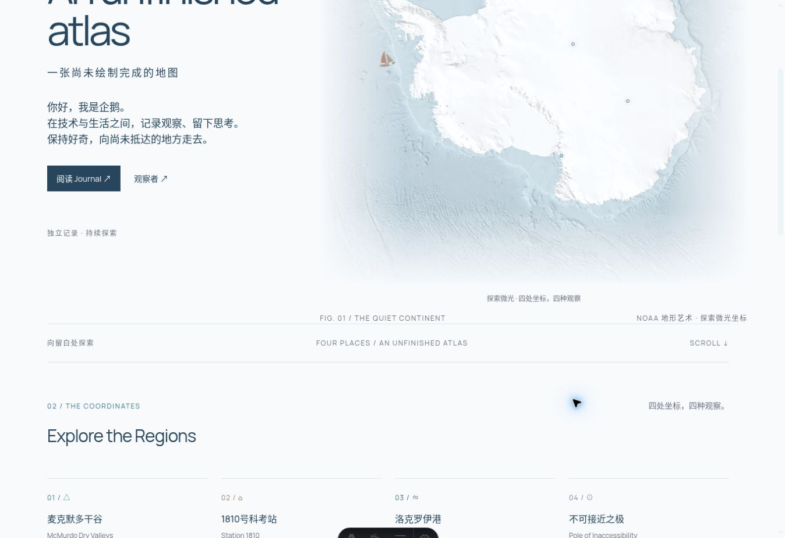
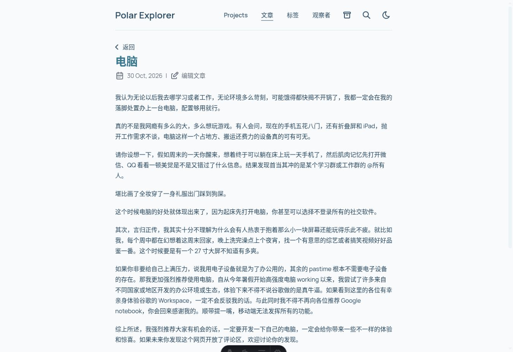
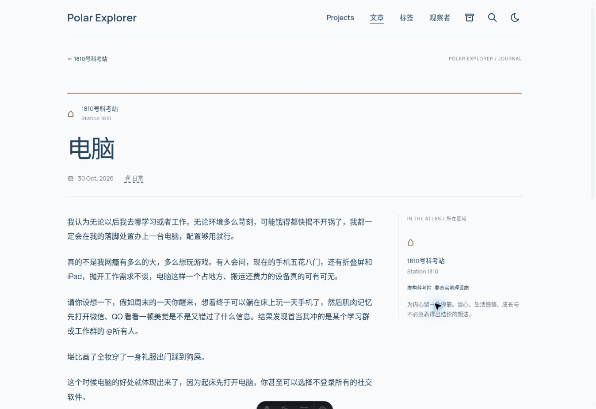
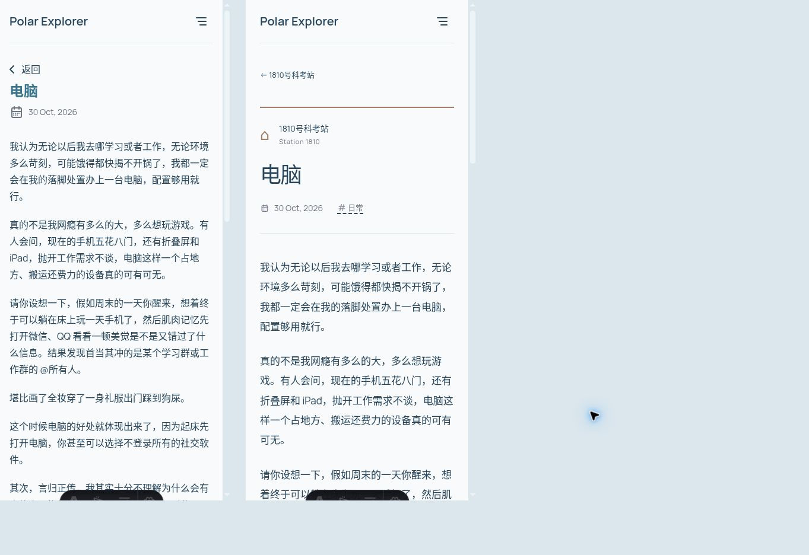
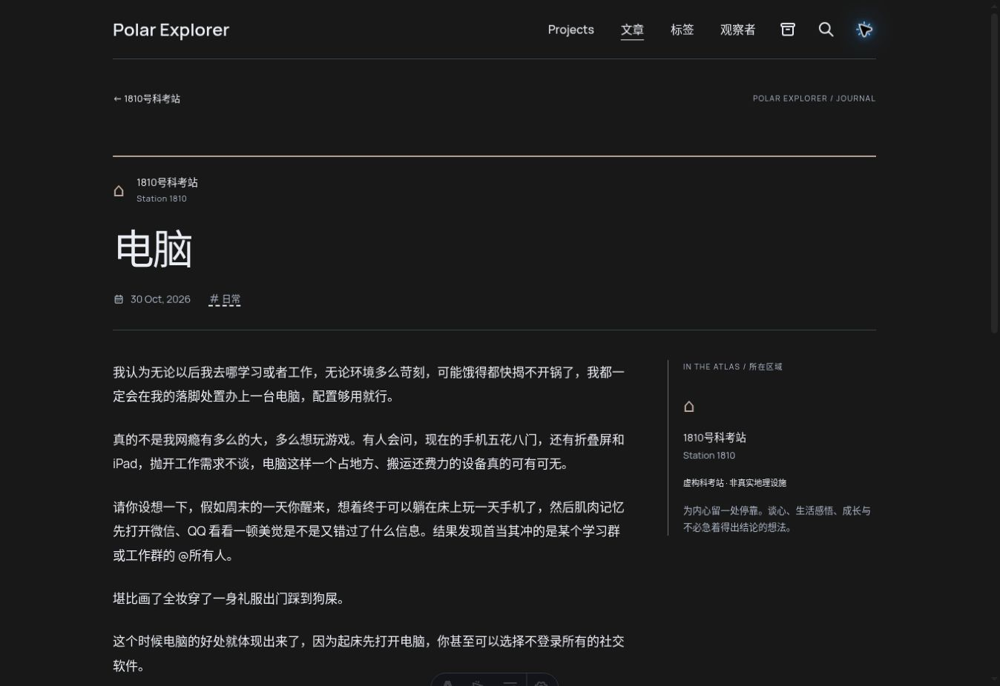

# Polar Explorer V2.3 — 视觉审核

基线：`9319171`（main，已合并帆船 PR #7 和统计 PR #8）。本轮仅开发分支，等待视觉审核。

## 首页

删除 atlas-index 整行、地图下重复提示与第二章节重复说明；保留一处 FIG.01 图注，以一条细分隔线连接 Explore the Regions。四区域入口保留。NOAA 来源追溯见 [NOAA-MAP.md](NOAA-MAP.md)。

| 改前 | 改后 |
| --- | --- |
|  |  |

真实浏览器截图；因删除了整行和重复文字，两图页面滚动位置不完全相同。

## 统一阅读模板

整体最大 1120px（扣除左右 40px 内边距，内容 1040px），阅读栏最大 700px，桌面旁栏提供真实区域信息和按文章标题生成的目录。没有区域不显示区域信息，少于两个标题不显示目录。手机端单栏，区域身份置于标题上方，隐藏地理辅助栏，长目录限制高度。中文正文 17px、1.95 行高。

| 改前 | 改后 |
| --- | --- |
|  |  |

## 四区域

模板从 regions.ts 读取名称、英文、颜色、符号和位置说明，无第二份区域配置。

| 区域 | 强调色 | 标识与地理内容 |
| --- | --- | --- |
| 麦克默多干谷 | #477C93 | △、77°S / 162°E 代表位置、学习研究介绍 |
| 1810号科考站 | #A17D67 | ⌂、明确标记虚构科考站、生活思考介绍 |
| 洛克罗伊港 | #506D7B | ≈、现有港口近似坐标与观察介绍 |
| 不可接近之极 | #8984A5 | ⊙、现有参考位置、保留未定义说明 |

标题顶部强调线、区域标识、旁栏细线、引用块及返回入口使用相同区域 token。深色模式混入少量浅色提高可见度；正文、标题比例、代码高亮、数学内容、分享区与布局始终统一。未给未分类文章分配区域。

## 验证

- frozen-lockfile 安装、lint、全仓格式检查、完整 build（Astro check、静态路由、OG、Pagefind）。
- Chrome 桌面真实浏览器：电脑区域身份、深浅色、未分类旧文、目录、图片键盘打开/Escape 关闭、底部返回科考站与 ClientRouter 导航。
- 390px iframe（包括浏览器滚动条，内容 viewport 375px）：中文单栏、隐藏辅助地理栏，页面无横向溢出。
- 另外三个区域用本地临时 Markdown 验证颜色、身份、引用、代码、表格与目录，临时内容在最终构建和提交前删除。
- 没有新增依赖；不改变原创正文、CMS/schema、NOAA 资源、四区域位置、帆船组件、统计 Layout。
- Reduced Motion：新增阅读 CSS 包含关闭动画/过渡的媒体查询，保留现有减少动画系统。浏览器系统级偏好未模拟；Edge、真实 iPhone Safari 未实测，需设备验收。

## 审核重点

请检查《电脑》的标题层级、中文密度、区域身份及手机端首段进入位置。短文章不强行生成目录、地图插画或无意义侧栏盒子。正式上线前等待视觉确认；本 PR 不自动合并、不部署 GitHub Pages。
